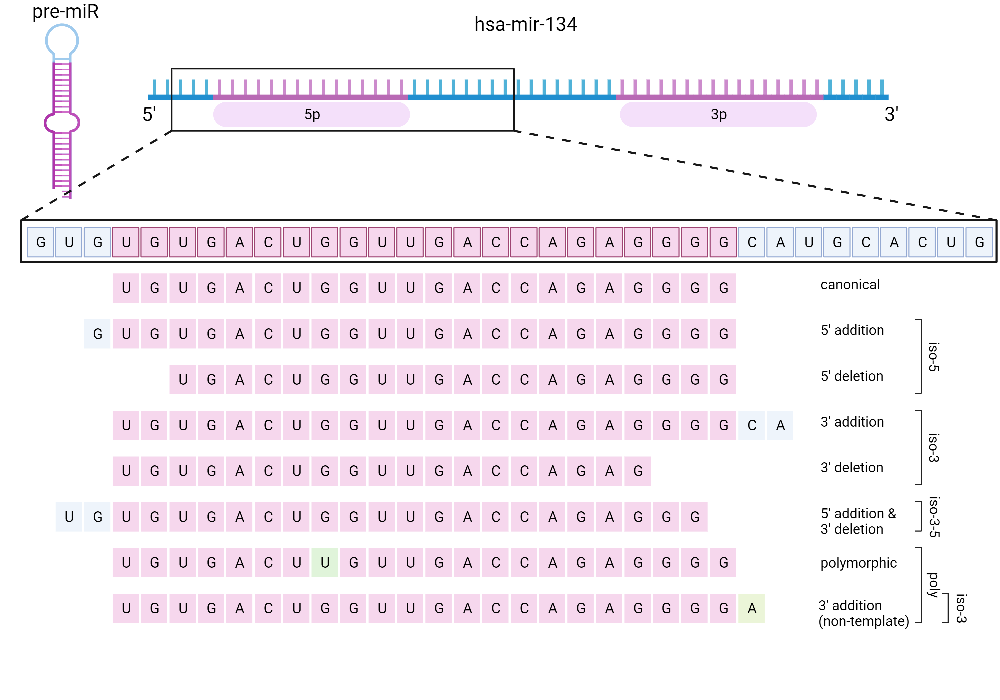

# isomiRScope classification rules

isomiRScope classifies every collapsed read that miRDeep2 assigned to a miRNA
precursor into a canonical form or an isomiR type, using only the alignment
information already present in the `miRBase.mrd` file. No re-mapping is done.

## Input

`quantifier.pl` from miRDeep2 writes `expression_analyses/expression_analyses_default/miRBase.mrd`.
The file is a concatenation of per-precursor blocks:

```
>hsa-mir-134
total read count                        456
hsa-miR-134-3p read count               4
hsa-miR-134-5p read count               452
remaining read count                    0
exp                                     fffffff5555555555555555555555ffffffffffffffff33333333333333333333333fffff
pri_seq                                 cagggugugugacugguugaccagaggggcaugcacuguguucacccugugggccaccuagucaccaacccuc
pri_struct                              .(((((..((((((((.((.(((.((((((((.....))))...)))).)))..)).))))))))..))))).	#MM
seq_5438193_x1                          ......gugugacugguugaccagaggg.............................................	0
seq_4329552_x252                        .......ugugacugguugaccagagggg............................................	0
seq_4703101_x39                         .......ugugacugguugaccagagggU............................................	1
```

Two lines carry all the information the classification needs:

- `exp` marks the position of the annotated mature products along the precursor.
  `5` = 5p arm, `3` = 3p arm, `M` = the single annotated mature product when the
  precursor has only one, `f` = flanking sequence.
- `seq_<id>_x<count>` lines give the alignment of a collapsed read against the
  precursor. Dots are unaligned positions, lowercase letters are matches and
  uppercase letters are mismatches. `<count>` is the number of reads collapsed
  into that sequence.

## Step 1 - parse the blocks (`prepare_tb_list`)

Each block is split into an `id` / `value` table on runs of two or more spaces,
the precursor name is added as a `mirbase_id` row, and the trailing mismatch
count after the tab is dropped. Precursors without a single `seq_` line are
discarded.

## Step 2 - locate the canonical arms (`prepare_annotation_tb`)

From the `exp` string, the first and last occurrence of each marker gives the
boundaries of the annotated mature products:

| Marker | Columns produced |
|---|---|
| `5` | `5_start`, `5_end` |
| `3` | `3_start`, `3_end` |
| `M` | `M_start`, `M_end` |

Markers that do not occur in `exp` yield `NA`, so a precursor with only a 5p
annotation has no 3p window.

## Step 3 - locate the reads (`prepare_position_tb`)

For every `seq_` line, `seq_start` is the position of the first alphabetic
character in the alignment string and `seq_end` the position of the last one.
These are precursor coordinates, directly comparable to the arm boundaries from
step 2.

## Step 4 - assign an arm (`annotate_isomirs`)

A read is assigned to an arm when both of its ends fall inside that arm's
tolerance window. With `L = seq_end - seq_start` (the read length minus one):

```
seq_start  in  [ arm_start - 2 ,  arm_start + L/2 ]
seq_end    in  [ arm_end   - L/2 ,  arm_end   + 5 ]
```

The asymmetric tolerance mirrors what miRDeep2 itself uses when counting reads
for a mature product: 2 nt upstream and 5 nt downstream of the annotated
sequence. The `L/2` terms keep a read from being assigned to an arm it only
overlaps by less than half its length.

Arms are tested in the order 5p, 3p, M, and the first match wins. A read that
matches no arm gets `canonical_type = NA` and is dropped in step 6.

## Step 5 - assign an isomiR type



Against the boundaries of the assigned arm:

| Condition | `isomir_type` |
|---|---|
| both ends match the arm exactly | `canonical` |
| both ends differ | `iso-3-5` |
| only the start differs | `iso-5` |
| only the end differs | `iso-3` |
| no arm was assigned | `wrong` |

Independently, a read whose alignment string contains any uppercase letter
carries at least one mismatch against the precursor and is flagged
`polymorphic = poly`.

The reported `isomir_name` joins the two with an underscore, omitting empty
parts: `canonical`, `iso-5`, `iso-3`, `iso-3-5`, `poly_canonical`, `poly_iso-5`,
`poly_iso-3`, `poly_iso-3-5`.

## Step 6 - name and count

The reported `mir_name` is the precursor name with the assigned arm appended
(`hsa-mir-134` + `5p` gives `hsa-mir-134-5p`). For precursors with a single
annotated mature product the `-M` suffix is dropped again, so the precursor name
is reported unchanged.

Reads with `isomir_type == "wrong"` are removed. The collapsed read identifier
`seq_4703101_x39` is split into `read_id` and `count`, and the table is written
as TSV.

## Output columns

| Column | Meaning |
|---|---|
| `read_id` | collapsed read identifier from the mrd file |
| `count` | number of reads collapsed into that sequence |
| `value` | alignment string against the precursor |
| `seq_start`, `seq_end` | read boundaries in precursor coordinates |
| `mir_name` | precursor name with the assigned arm appended |
| `isomir_name` | `isomir_type` combined with `polymorphic` |
| `isomir_type` | `canonical`, `iso-5`, `iso-3` or `iso-3-5` |
| `polymorphic` | `poly` if the read carries a mismatch, otherwise `NA` |

Columns are written in this order; `inst/extdata/example.expected.tsv` is the reference.

## Known limitations

- Classification is relative to the miRBase annotation used for the miRDeep2
  run. A different miRBase version shifts the arm boundaries and therefore the
  isomiR calls.
- The `poly` flag is raised by any mismatch against the precursor, so it mixes
  internal variation (SNP, RNA editing, sequencing error) with non-templated end
  additions. A templated 3' addition is reported as `iso-3`, a non-templated one
  as `poly_iso-3`; the position of the mismatch is not reported, only the
  alignment string from which it can be recovered.
- Reads are only classified against precursors miRDeep2 already assigned them
  to. A read mapping to several precursors is counted for each of them, as in
  the miRDeep2 output.
- A read that falls inside the tolerance window of more than one arm is assigned
  to the first match in the order 5p, 3p, M.
